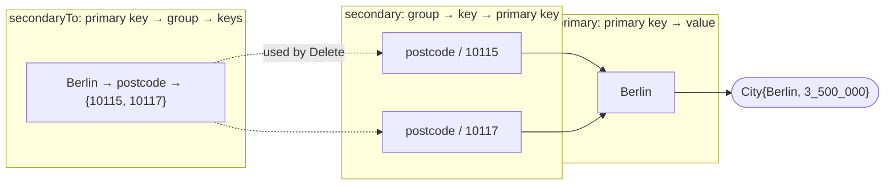
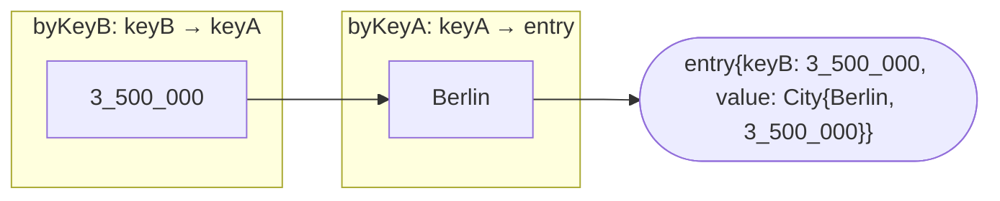

# go-multikeymap

See docs: https://pkg.go.dev/github.com/aeimer/go-multikeymap

DISCLAIMER: Until version 1 is reached, the API may change.

A go lib which handles maps with multiple keys.
Both data-structures are available in go routine safe (concurrent) and a non-concurrent version.
The zero value of every type is ready to use, `New` is optional.
Iterators (`All`, `Keys`, `Values`) follow the standard library; their order is unspecified, like for a Go map.
The iterators of the concurrent types work on a snapshot, so the loop body may write to the map.

* **MultiKeyMap** is a data structure based on go native maps.
It has a primary key which directly maps to the values.
The secondary keys are mapping to the primary key.
Therefore, the memory consumption is a bit higher than a native map.
The access is O(1+1+1) => O(1) due to the underlying hashmap.

* **BiKeyMap** is a stricter version of MultiKeyMap.
It has KeyA and KeyB, both need to be unique.
The access is O(1+1) => O(1) due to the underlying hashmap.

## MultiKeyMap

This map has a generic primary key and multiple string secondary keys.
You can use it like this:

```go
package main

import (
  "fmt"

  "github.com/aeimer/go-multikeymap/multikeymap"
)

func main() {
  type City struct {
    Name       string
    Population int
  }
  mm := multikeymap.New[string, City]()
  // or: mm := multikeymap.NewConcurrent[string, City]()
  // the zero value works too: var mm multikeymap.MultiKeyMap[string, City]
  mm.Set("Berlin", City{"Berlin", 3_500_000})
  mm.AddSecondaryKeys("Berlin", "postcode", "10115", "10117", "10119")
  mm.Get("Berlin")                          // City{"Berlin", 3_500_000}, true
  mm.GetBySecondaryKey("postcode", "10115") // City{"Berlin", 3_500_000}, true
  mm.PrimaryKey("postcode", "10117")        // "Berlin", true

  for group, key := range mm.SecondaryKeys("Berlin") {
    fmt.Println(group, key) // postcode 10115, postcode 10117, ...
  }
  for name, city := range mm.All() {
    fmt.Println(name, city.Population)
  }
  // Atomic compound operations, also on the concurrent map.
  mm.LoadOrStore("Hamburg", City{"Hamburg", 1_800_000}) // City{"Hamburg", 1_800_000}, false
  mm.Update("Hamburg", func(old City, exists bool) (City, bool) {
    old.Population += 1_000
    return old, true // false deletes the entry
  })

  c := mm.Clone() // independent copy; values are copied by assignment
  c.DeleteFunc(func(name string, city City) bool { return city.Population < 2_000_000 })

  mm.DeleteSecondaryKey("postcode", "10119") // keep Berlin, drop one key
  mm.DeleteGroup("postcode")                 // drop all postcodes
  mm.DeleteBySecondaryKey("plate", "HH")     // no-op: the key does not exist
  value, ok := mm.LoadAndDelete("Berlin")    // City{"Berlin", 3_500_000}, true
  fmt.Println(value, ok)
  mm.Len() // 1
}
```

Benchmark results (`task tb`), measured on an Apple M5 Pro with Go 1.27.

```
# => Non-Concurrent <=                            Iterations
BenchmarkMultiKeyMapGet/size_100-18                  2144828     585.1 ns/op       0 B/op      0 allocs/op
BenchmarkMultiKeyMapGet/size_1000-18                   92668     12964 ns/op    2880 B/op    900 allocs/op
BenchmarkMultiKeyMapGet/size_10000-18                   8082    149555 ns/op   38880 B/op   9900 allocs/op
BenchmarkMultiKeyMapGet/size_100000-18                   631   1926035 ns/op  518884 B/op  99900 allocs/op

BenchmarkMultiKeyMapSet/size_100-18                  1655570     643.0 ns/op       0 B/op      0 allocs/op
BenchmarkMultiKeyMapSet/size_1000-18                   84871     13972 ns/op    2881 B/op    900 allocs/op
BenchmarkMultiKeyMapSet/size_10000-18                   7207    162457 ns/op   39001 B/op   9900 allocs/op
BenchmarkMultiKeyMapSet/size_100000-18                   483   2420619 ns/op  533354 B/op  99901 allocs/op

BenchmarkMultiKeyMapDelete/size_100-18                 88156     13459 ns/op       0 B/op      0 allocs/op
BenchmarkMultiKeyMapDelete/size_1000-18                 8210    150100 ns/op    2892 B/op    900 allocs/op
BenchmarkMultiKeyMapDelete/size_10000-18                 709   1660875 ns/op   38943 B/op   9900 allocs/op
BenchmarkMultiKeyMapDelete/size_100000-18                 57  20378743 ns/op  518885 B/op  99900 allocs/op

# => Concurrent <=                                Iterations
BenchmarkConcurrentMultiKeyMapGet/size_100-18        1563883     735.7 ns/op       0 B/op      0 allocs/op
BenchmarkConcurrentMultiKeyMapGet/size_1000-18         80565     15050 ns/op    2880 B/op    900 allocs/op
BenchmarkConcurrentMultiKeyMapGet/size_10000-18         7064    173346 ns/op   38881 B/op   9900 allocs/op
BenchmarkConcurrentMultiKeyMapGet/size_100000-18         525   2318034 ns/op  518893 B/op  99900 allocs/op

BenchmarkConcurrentMultiKeyMapSet/size_100-18        1000000      1297 ns/op       0 B/op      0 allocs/op
BenchmarkConcurrentMultiKeyMapSet/size_1000-18         65265     18487 ns/op    2881 B/op    900 allocs/op
BenchmarkConcurrentMultiKeyMapSet/size_10000-18         5636    218227 ns/op   39035 B/op   9900 allocs/op
BenchmarkConcurrentMultiKeyMapSet/size_100000-18         385   3125797 ns/op  537037 B/op  99901 allocs/op

BenchmarkConcurrentMultiKeyMapDelete/size_100-18       85387     13867 ns/op       0 B/op      0 allocs/op
BenchmarkConcurrentMultiKeyMapDelete/size_1000-18       7920    165475 ns/op    2894 B/op    900 allocs/op
BenchmarkConcurrentMultiKeyMapDelete/size_10000-18       705   1777658 ns/op   38934 B/op   9900 allocs/op
BenchmarkConcurrentMultiKeyMapDelete/size_100000-18       58  20745164 ns/op  518880 B/op  99900 allocs/op
```

## BiKeyMap

This map has two generic keys, both need to be unique.
You can use it like this:

```go
package main

import (
  "errors"
  "fmt"

  "github.com/aeimer/go-multikeymap/bikeymap"
)

func main() {
  type City struct {
    Name       string
    Population int
  }
  // keyA: Cityname, keyB: Population
  bm := bikeymap.New[string, int, City]()
  // or: bm := bikeymap.NewConcurrent[string, int, City]()
  // the zero value works too: var bm bikeymap.BiKeyMap[string, int, City]
  _ = bm.Set("Berlin", 3_500_000, City{"Berlin", 3_500_000})
  _ = bm.Set("Hamburg", 1_800_000, City{"Hamburg", 1_800_000})
  bm.GetByKeyA("Berlin")  // City{"Berlin", 3_500_000}, true
  bm.GetByKeyB(1_800_000) // City{"Hamburg", 1_800_000}, true
  bm.KeyA(1_800_000)      // "Hamburg", true
  bm.KeyB("Berlin")       // 3_500_000, true

  // Both keys must stay unique.
  err := bm.Set("Munich", 3_500_000, City{"Munich", 1_500_000})
  errors.Is(err, bikeymap.ErrKeyBConflict) // true

  for name := range bm.KeysA() {
    fmt.Println(name)
  }
  bm.DeleteByKeyB(1_800_000)
  bm.LoadAndDeleteByKeyA("Berlin") // City{"Berlin", 3_500_000}, true

  c := bm.Clone() // independent copy; values are copied by assignment
  c.DeleteFunc(func(name string, population int, city City) bool { return population < 1_000_000 })
  bm.Len() // 0
}
```

Benchmark results (`task tb`), measured on an Apple M5 Pro with Go 1.27.

```
# => Non-Concurrent <=                        Iterations
BenchmarkBiKeyMapGet/size_100-18                  727411     1660 ns/op        0 B/op       0 allocs/op
BenchmarkBiKeyMapGet/size_1000-18                  56086    21153 ns/op     2880 B/op     900 allocs/op
BenchmarkBiKeyMapGet/size_10000-18                  4726   255093 ns/op    38881 B/op    9900 allocs/op
BenchmarkBiKeyMapGet/size_100000-18                  332  3743670 ns/op   518880 B/op   99900 allocs/op

BenchmarkBiKeyMapSet/size_100-18                  605773     2130 ns/op        0 B/op       0 allocs/op
BenchmarkBiKeyMapSet/size_1000-18                  35040    34782 ns/op     5768 B/op    1800 allocs/op
BenchmarkBiKeyMapSet/size_10000-18                  3085   383540 ns/op    78552 B/op   19800 allocs/op
BenchmarkBiKeyMapSet/size_100000-18                  238  5048236 ns/op  1120042 B/op  199804 allocs/op

BenchmarkBiKeyMapDelete/size_100-18               220062     5450 ns/op        0 B/op       0 allocs/op
BenchmarkBiKeyMapDelete/size_1000-18               22471    53713 ns/op        0 B/op       0 allocs/op
BenchmarkBiKeyMapDelete/size_10000-18               2036   593179 ns/op        0 B/op       0 allocs/op
BenchmarkBiKeyMapDelete/size_100000-18               147  8209722 ns/op        0 B/op       0 allocs/op

# => Concurrent <=                            Iterations
BenchmarkConcurrentBiKeyMapGet/size_100-18        619512     1985 ns/op        0 B/op       0 allocs/op
BenchmarkConcurrentBiKeyMapGet/size_1000-18        44323    26994 ns/op     2880 B/op     900 allocs/op
BenchmarkConcurrentBiKeyMapGet/size_10000-18        3844   313419 ns/op    38880 B/op    9900 allocs/op
BenchmarkConcurrentBiKeyMapGet/size_100000-18        267  4440407 ns/op   518880 B/op   99900 allocs/op

BenchmarkConcurrentBiKeyMapSet/size_100-18        451846     2459 ns/op        0 B/op       0 allocs/op
BenchmarkConcurrentBiKeyMapSet/size_1000-18        30844    38602 ns/op     5769 B/op    1800 allocs/op
BenchmarkConcurrentBiKeyMapSet/size_10000-18        2392   457005 ns/op    78781 B/op   19800 allocs/op
BenchmarkConcurrentBiKeyMapSet/size_100000-18        199  5948356 ns/op  1136140 B/op  199805 allocs/op

BenchmarkConcurrentBiKeyMapDelete/size_100-18     205885     5807 ns/op        0 B/op       0 allocs/op
BenchmarkConcurrentBiKeyMapDelete/size_1000-18     20644    58138 ns/op        0 B/op       0 allocs/op
BenchmarkConcurrentBiKeyMapDelete/size_10000-18     1902   639700 ns/op        0 B/op       0 allocs/op
BenchmarkConcurrentBiKeyMapDelete/size_100000-18     141  8465134 ns/op        0 B/op       0 allocs/op
```

## How it works

Both maps store each value once.
The other keys point to the key that holds the value, so a lookup costs one or two hash map accesses.

### MultiKeyMap

Three Go maps, shown with the example data from above:



- `Get` reads `primary`.
- `GetBySecondaryKey` reads `secondary`, then `primary`.
- `secondaryTo` is the reverse index: `Delete` uses it to remove all secondary keys of a primary key without scanning every group.

### BiKeyMap

Two Go maps:



- `GetByKeyA` reads `byKeyA`.
- `GetByKeyB` reads `byKeyB`, then `byKeyA`.
- The entry stores keyB next to the value, so `DeleteByKeyA` finds keyB without a third map.

### Concurrent variants

`ConcurrentMultiKeyMap` and `ConcurrentBiKeyMap` wrap the plain type and a `sync.RWMutex`.
Reads take the read lock, writes take the write lock, and each method then calls the plain method.
Iterators copy the data under the read lock when the range starts and iterate over that snapshot.

## Contribution

Feel free to contribute by opening issues or pull requests.
To set up the project, you need to have go installed.
Then you can run the following commands:

```bash
# List Taskfile tasks
task

# Install dependencies
task setup

# Run tests
task test

# Run benchmarks
task test-bench
```

## Star history

[](https://star-history.com/#aeimer/go-multikeymap&Date)
